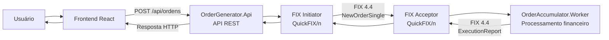

# FixOrderManagement

O FixOrderManagement é uma aplicação para envio, processamento e acompanhamento de ordens financeiras por meio do protocolo FIX 4.4. A solução separa o recebimento das solicitações, feito por uma API ASP.NET Core, do processamento das ordens e do controle de exposição financeira, feito por um Worker independente.

Uma interface React permite enviar ordens de compra ou venda e acompanhar o resultado retornado pelo backend.

## Tecnologias

| Área        | Tecnologias                                                          |
| ----------- | -------------------------------------------------------------------- |
| Backend     | C#, .NET 10, ASP.NET Core Web API, FluentValidation, Swagger/OpenAPI |
| Frontend    | React, TypeScript, Vite e CSS                                        |
| Comunicação | QuickFIX/n e protocolo FIX 4.4                                       |
| Testes      | Projetos xUnit configurados na solução                               |

## Arquitetura

### OrderGenerator.Api

A API REST recebe e valida os dados da ordem, gera um identificador único, envia a mensagem `NewOrderSingle` pelo FIX Initiator e correlaciona a resposta `ExecutionReport` com a solicitação pendente.

### OrderAccumulator.Worker

O Worker executa como processo independente e atua como FIX Acceptor. Ele recebe e processa ordens, calcula a exposição por ativo e responde pelo protocolo FIX com a aceitação ou rejeição da ordem.

### Frontend React

A interface permite selecionar o símbolo e o lado da ordem, informar quantidade e preço, e visualizar o resultado do processamento. O preço é apresentado em reais com uma máscara monetária.



## Funcionalidades

- Envio de ordens de compra e venda para PETR4, VALE3 e VIIA4.
- Validação dos dados de entrada na API e no formulário.
- Comunicação entre API e Worker usando mensagens FIX 4.4.
- Controle de exposição financeira individual por símbolo.
- Aceitação ou rejeição de ordens conforme a exposição projetada.
- Processamento atômico da exposição e controle de ordens repetidas no Worker.
- Correlação entre solicitações pendentes e respostas FIX.
- Tratamento de sessão FIX indisponível e timeout.

## Regras de negócio

- A quantidade deve ser um inteiro entre 1 e 99.999.
- O preço deve ser maior que R$ 0,00, menor que R$ 1.000,00 e possuir precisão de centavos.
- O valor da ordem é calculado como quantidade multiplicada pelo preço.
- Compras aumentam a exposição do símbolo; vendas a reduzem.
- Cada símbolo possui sua própria exposição, limitada ao intervalo de -R$ 100.000.000,00 a R$ 100.000.000,00, inclusive.
- Uma ordem que ultrapassa esse intervalo é rejeitada e não altera a exposição.
- A exposição e o histórico de ordens processadas ficam em memória no Worker e são reiniciados quando o processo é encerrado.

Por exemplo, uma compra de 100 ações a R$ 35,50 aumenta a exposição do símbolo em R$ 3.550,00. Uma venda posterior de 40 ações a R$ 35,50 reduz essa exposição em R$ 1.420,00.

O Worker processa solicitações concorrentes com atualização protegida por uma região crítica. Quando recebe novamente um identificador FIX já processado com os mesmos dados, retorna o resultado registrado sem aplicar a exposição de novo. Um identificador reutilizado com dados diferentes é tratado como conflito. Esse mecanismo se aplica ao identificador FIX recebido pelo Worker; a API gera um identificador novo para cada solicitação HTTP.

## Pré-requisitos

- Git, para clonar o repositório.
- .NET SDK 10.
- Node.js 20.19 ou superior na série 20, ou 22.12 ou superior. Essas versões atendem ao requisito do Vite instalado; versões posteriores compatíveis também podem ser usadas.
- npm, incluído na instalação do Node.js.
- Portas locais disponíveis: 5259 para HTTP da API, 7003 para HTTPS opcional da API, 5173 para o frontend e 5001 para a sessão FIX.

Não é necessário instalar um banco de dados. A exposição financeira e o histórico de processamento ficam em memória durante a execução do Worker.

## Instalação e execução

Os comandos abaixo partem da raiz do repositório. Execute cada processo em um terminal separado.

### 1. Clonar o repositório

```bash
git clone https://github.com/LucasLott/FixOrderManagement.git
cd FixOrderManagement
```

### 2. Restaurar dependências do backend

```bash
dotnet restore FixOrderManagement.sln
```

### 3. Compilar a solução

```bash
dotnet build FixOrderManagement.sln
```

### 4. Iniciar o OrderAccumulator.Worker

Na raiz do repositório, execute:

```bash
dotnet run --project src/OrderAccumulator.Worker/OrderAccumulator.Worker.csproj
```

O projeto inclui `fix/acceptor.cfg` e o dicionário FIX 4.4 em seu diretório de saída. O Acceptor aguarda conexões na porta 5001.

### 5. Iniciar o OrderGenerator.Api

Em outro terminal, na raiz do repositório:

```bash
dotnet run --project src/OrderGenerator.Api/OrderGenerator.Api.csproj --launch-profile http
```

A API ficará disponível em `http://localhost:5259`. Em Development, a interface Swagger fica em `http://localhost:5259/swagger`. O perfil HTTPS também configura `https://localhost:7003` e `http://localhost:5259`.

A configuração de desenvolvimento permite chamadas CORS de `http://localhost:5173`. O FIX Initiator conecta-se ao Acceptor em `127.0.0.1:5001` e tenta reconectar a cada cinco segundos. Para processar ordens, mantenha o Worker ativo e a sessão FIX estabelecida.

### 6. Iniciar o frontend

Em outro terminal:

```bash
cd client
npm install
```

Configure `VITE_API_BASE_URL` em um arquivo `.env.local`, usando o valor do exemplo fornecido em `.env.example`:

```dotenv
VITE_API_BASE_URL=http://localhost:5259
```

Depois, inicie o servidor de desenvolvimento:

```bash
npm run dev
```

O Vite usa a porta 5173. Se a API estiver em outro endereço, ajuste `VITE_API_BASE_URL` e reinicie o frontend.

## Configuração FIX

Os arquivos de sessão ficam no diretório `fix/`:

| Arquivo             | Papel                      | Identificação da sessão                              |
| ------------------- | -------------------------- | ---------------------------------------------------- |
| `fix/initiator.cfg` | Conexão iniciada pela API  | SenderCompID `GENERATOR`, TargetCompID `ACCUMULATOR` |
| `fix/acceptor.cfg`  | Conexão aceita pelo Worker | SenderCompID `ACCUMULATOR`, TargetCompID `GENERATOR` |

Ambos configuram `BeginString=FIX.4.4`. O Initiator usa o host `127.0.0.1`, porta `5001` e intervalo de reconexão de cinco segundos. O Acceptor escuta na porta `5001`. Os projetos copiam seus arquivos de configuração e o dicionário `FIX44.xml` para o diretório de saída durante o build.

## Exemplo de uso da API

O endpoint de criação de ordens é `POST /api/ordens`.

Requisição:

```json
{
  "simbolo": "PETR4",
  "lado": "Compra",
  "quantidade": 100,
  "preco": 35.5
}
```

Exemplo de resposta HTTP 200 para uma ordem aceita:

```json
{
  "identificadorOrdem": "d5d0f065d7764bb2a41c17289f2546a1",
  "simbolo": "PETR4",
  "aceita": true,
  "motivoRejeicao": null,
  "identificadorExecucao": "EXEC-123",
  "identificadorOrdemServidor": "ORD-456"
}
```

Os identificadores acima são ilustrativos. O DTO também retorna `motivoRejeicao` quando aplicável. Uma ordem aceita ou rejeitada por regra de negócio retorna HTTP 200; consulte `aceita` e `motivoRejeicao` para distinguir os resultados. Os principais erros técnicos são:

| Código HTTP | Significado                                                            |
| ----------- | ---------------------------------------------------------------------- |
| 400         | Dados da requisição inválidos                                          |
| 503         | Sessão FIX indisponível ou falha no envio                              |
| 504         | Tempo limite aguardando a resposta FIX; o resultado não foi confirmado |
| 500         | Falha interna durante o processamento                                  |

## Testes

A solução contém os projetos `OrderGenerator.Tests` e `OrderAccumulator.Tests`. Para executá-los:

```bash
dotnet test FixOrderManagement.sln
```

Atualmente, esses diretórios contêm os projetos e suas configurações, mas não foram encontrados arquivos de casos de teste.

## Estrutura do repositório

```text
FixOrderManagement/
├── Build/
│   ├── Directory.Build.props
│   └── Directory.Packages.props
├── client/
│   └── src/
│       ├── components/
│       ├── services/
│       ├── styles/
│       └── types/
├── fix/
│   ├── acceptor.cfg
│   └── initiator.cfg
├── src/
│   ├── OrderAccumulator.Worker/
│   └── OrderGenerator.Api/
├── tests/
│   ├── OrderAccumulator.Tests/
│   └── OrderGenerator.Tests/
└── FixOrderManagement.sln
```

## Considerações técnicas

- API e Worker são processos independentes, com responsabilidades separadas e sem referência direta entre os projetos executáveis.
- O FIX 4.4, implementado com QuickFIX/n, é o contrato de comunicação entre os serviços.
- A exposição financeira e o histórico de processamento ficam em memória no Worker; ao reiniciar o processo, esses dados são perdidos. Os arquivos de store do QuickFIX/n servem à sessão FIX e não persistem a exposição de negócio.
- Aceitações e rejeições de negócio são retornadas como resultados da ordem. Falhas de sessão e timeout são respostas HTTP técnicas distintas.
- O Worker evita reaplicar uma mensagem repetida com o mesmo identificador FIX e os mesmos dados financeiros. Identificadores repetidos com dados diferentes são rejeitados como conflito.

## Créditos

> This is a challenge by [Coodesh](https://coodesh.com/).
